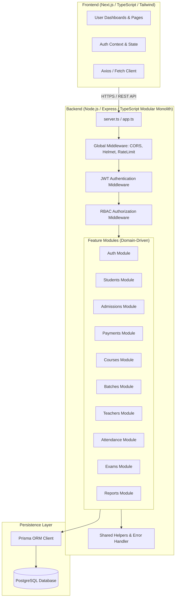

# System Architecture Design: Coaching Management Software

## 1. Architecture Overview

The **Coaching Management Software** is architected as a **Feature-based Modular Monolith** powered by a **REST API** backend and a modern single-page frontend. This architectural paradigm achieves a balance between the operational simplicity of a monolithic deployment and the clean separation of concerns typical of microservices.

- **Frontend**: Built with **Next.js** (App Router), **TypeScript**, **Tailwind CSS**, and **Lucide React**. It utilizes role-based layouts, robust client-side validation (Zod), and print-optimized CSS for payment card generation.
- **Backend**: Built with **Node.js**, **Express.js**, **TypeScript**, **Prisma ORM**, and **PostgreSQL**. The backend codebase is strictly partitioned into autonomous business modules (`auth`, `students`, `admissions`, `payments`, `courses`, `batches`, `teachers`, `attendance`, `exams`, `reports`) communicating through explicit internal service contracts and shared middleware.
- **Data Persistence**: Relational data storage managed via **PostgreSQL** with schema management and type safety handled by **Prisma ORM**.
- **Security**: Centralized JSON Web Token (JWT) authentication, Role-Based Access Control (RBAC) middleware, cryptographic QR tokens, and hashed passwords (bcrypt).

---

## 2. System Architecture Diagram



---

## 3. Frontend Architecture

The frontend application (`frontend/src/`) adheres to a feature-first component and routing convention, organized within the Next.js App Router structure:

### 3.1. App Router Structure & Route Groups
- `src/app/(auth)/login/` - Public authentication entry point.
- `src/app/(dashboard)/` - Protected role-based dashboard layout utilizing route groups or dynamic routing paths per role (`/admin`, `/helpdesk`, `/receptionist`, `/founding-member`).
- `src/app/verify/` - Public QR code verification page.

### 3.2. Role-Based Dashboard Navigation
- **Dynamic Layout & Sidebar**: Conditional sidebar navigation rendered based on the authenticated user's role.
- **Route Guarding**: Next.js layout wrappers and middleware inspect JWT claims to prevent unauthorized route access (e.g., preventing a Receptionist from accessing Founding Member approval queues).

### 3.3. Component Organization & Shared UI
- **Feature Components**: Grouped by domain (e.g., `src/components/payments/PaymentCardView.tsx`, `src/components/students/StudentSearchForm.tsx`).
- **Shared UI (`src/components/ui/`)**: Reusable primitives built with Tailwind CSS and Lucide React icons (Buttons, Modals, Tables, Cards, Badges).

### 3.4. API Communication & State Management
- **HTTP Client**: Centralized Axios instance with request interceptors attaching Bearer tokens and response interceptors handling 401/403 errors.
- **State Management**: React Context API for lightweight global authentication and user session state; React Query (TanStack Query) for asynchronous server-state management, caching, and optimistic updates.

### 3.5. Form Handling, Validation & Error States
- **Forms**: React Hook Form paired with Zod schemas for rigorous client-side input validation.
- **UX States**: Standardized skeleton loaders, inline error banners, and toast notifications for asynchronous operations.

### 3.6. Image Upload & Payment Card Printing
- **Image Upload**: Client-side image cropping and preview with multipart/form-data upload to backend storage.
- **Payment Card Printing**: Tailwind CSS print styles (`@media print`) ensuring exact physical card dimensions, logo watermark placement, and scannable QR code clarity.

---

## 4. Backend Architecture

The backend (`backend/src/`) is structured as a Feature-based Modular Monolith.

### 4.1. Request Flow
```
Client Request → app.js / server.js → Global Middleware → Auth Middleware → RBAC Middleware → Module Router → Controller → Service Layer → Prisma ORM → PostgreSQL
```

### 4.2. Layer Responsibilities
1. **Routes (`routes.js`)**: Define endpoint paths and bind HTTP methods to controllers, inserting module-specific authentication and authorization middleware.
2. **Controllers (`controllers/`)**: Handle HTTP protocol concerns—extracting request parameters, query strings, and body payloads; invoking services; and returning standardized JSON responses. **Controllers contain zero business logic.**
3. **Services (`services/`)**: House all core business logic, transaction orchestration, state transitions, and inter-module calls.
4. **Data Access / Prisma**: Direct interaction with Prisma ORM client models (`prisma.<model>.<operation>`).

### 4.3. Cross-Cutting Concerns
- **Centralized Error Handling**: Global Express error-handling middleware that catches synchronous and asynchronous errors, logs them, and returns standardized JSON error envelopes.
- **Request Validation**: Express-validator or Zod validation middleware executed prior to controllers.
- **Logging**: Morgan or Winston structured logging middleware.

---

## 5. Module Responsibilities

| Module | Core Responsibilities | Dependencies |
| :--- | :--- | :--- |
| **`auth`** | User login, token generation, password hashing, user session verification. | None (Core infrastructure) |
| **`students`** | Student profile creation, Token Number generation, profile search, demographic updates. | `auth` |
| **`courses`** | Course creation, fee configuration, category management (Admin only). | `auth` |
| **`admissions`** | Managing student-to-course enrollments and enrollment statuses. | `students`, `courses`, `auth` |
| **`payments`** | Payment entry creation (`PENDING`), approval workflow, rejection reasons, audit logs, QR verification. | `students`, `admissions`, `auth` |
| **`batches`** | Organizing students and teachers into academic batches. | `students`, `teachers`, `courses`, `auth` |
| **`teachers`** | Managing teacher profiles, assignments, and schedules. | `auth` |
| **`attendance`** | Tracking student and teacher attendance records. | `students`, `batches`, `teachers`, `auth` |
| **`exams`** | Exam scheduling, mark entry, and grade reporting. | `students`, `batches`, `courses`, `auth` |
| **`reports`** | Generating financial, attendance, and academic reports. | All modules (Read-only aggregation) |


---

## 6. Module Communication

- **Intra-Module Calls**: Services can directly invoke public service functions of other modules (e.g., `PaymentsService` calling `StudentsService.getStudentByToken()`).
- **Avoiding Circular Dependencies**: Strict dependency hierarchy. Core domain modules (`students`, `courses`) have zero downstream dependencies on `payments` or `reports`. Shared utilities reside in `backend/src/shared/`.

---

## 7. Payment Module Architecture (Priority 1)

The payment workflow spans multiple modules and UI touchpoints:
1. **Helpdesk Interface**: Interacts with `StudentsModule` for token generation and profile search.
2. **Receptionist Interface**: Interacts with `CoursesModule` (to fetch fees) and `PaymentsModule` (to submit payment entries with status `PENDING`).
3. **Founding Member Dashboard**: Interacts with `PaymentsModule` pending approval queue to verify, approve (`APPROVED`), or reject (`REJECTED` with reason).
4. **Payment Card & QR Generator**: Automatically triggered upon successful approval, rendering the QR token linked to `payments` verification tables.
5. **QR Verification Page (`/verify`)**: Public endpoint validating payment approval status and returning sanitized student/course details.

---

## 8. Authentication & Authorization Architecture

- **JWT Authentication**: Stateless JSON Web Tokens issued upon successful login containing `userId`, `role`, and `email`.
- **RBAC Middleware**: Express middleware factory `authorize(['ADMIN', 'FOUNDING_MEMBER'])` verifying role claims against route requirements.
- **Password Security**: Bcrypt hashing with a work factor of 12.

---

## 9. File Management Architecture

- **Storage Strategy**: Local filesystem storage (`backend/uploads/`) structured by category (`students/photos/`, `institution/logo/`, `watermarks/`), with a clear abstraction layer allowing future migration to AWS S3 or Cloudinary.
- **Access Control**: Student photos and payment cards are protected behind authenticated or token-verified endpoints; public QR verification endpoints serve only necessary non-sensitive data.

---

## 10. Architectural Decisions & Trade-offs

| Decision | Chosen Approach | Alternatives Considered | Trade-offs & Disadvantages |
| :--- | :--- | :--- | :--- |
| **Backend Language** | TypeScript | JavaScript | Requires compilation step and type definitions; vastly superior type safety and refactoring confidence for enterprise domain logic. |
| **Architecture Style** | Modular Monolith | Microservices | Slightly larger initial deployment package; avoids severe distributed system complexity, network latency, and operational overhead. |
| **Validation Layer** | Module-specific Zod / Express-Validator | Global monolithic validation | Mildly repetitive schema definitions; perfectly isolates module validation rules and keeps domains decoupled. |
| **Database Access** | Direct Prisma ORM Client | Repository Classes over Prisma | Prisma client acts as an enterprise-grade repository abstraction; adding an extra repository class layer creates unnecessary boilerplate. |
| **Authentication** | JWT (JSON Web Tokens) | Server-side Sessions (Redis/DB) | Stateless and scales effortlessly; revocation requires token blacklisting mechanisms or short expiration times. |
| **File Storage** | Local Filesystem with Abstraction | Direct PostgreSQL BYTEA storage | Database bloat and slow I/O; local storage requires managed backup volumes or cloud migration for horizontal scaling. |

---

## 11. Future Scalability Considerations

1. **Microservices Extraction**: Because modules are encapsulated in `src/modules/`, business logic can be extracted into standalone Node.js microservices with minimal refactoring.
2. **Read/Write DB Splitting**: Prisma connection pooling allows easy routing of heavy `reports` queries to read-replica PostgreSQL instances.
3. **Caching Layer**: Redis can be integrated into `shared/` for caching active course catalogs and token lookup results.

