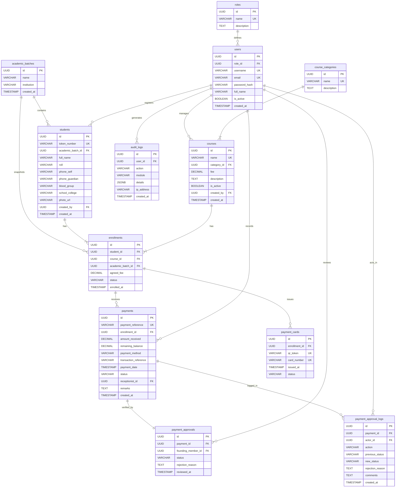

# Database Design & Architecture: Coaching Management Software

## 1. Database Architecture Overview

The database design for the **Coaching Management Software** is architected for PostgreSQL using Prisma ORM. It follows third normal form (3NF) principles while incorporating performance indexes, role-based access control tables, academic batch tracking, financial integrity safeguards, and audit logging.

- **DBMS**: PostgreSQL 15+
- **ORM**: Prisma ORM
- **Monetary Storage**: PostgreSQL `DECIMAL(10, 2)` for precise currency handling without floating-point inaccuracies.
- **Identifiers**: UUIDs (`UUID PK`) for distributed uniqueness and security, or foreign key references.

---

## 2. Design Principles

1. **Financial Integrity**: Course fees are locked into student enrollments (`agreed_fee`) to prevent historical corruption when admin course fees change. Balances are calculated dynamically from verified transactions.
2. **Auditability & Approval Logs**: Every payment review lifecycle event (submission, rejection, resubmission, approval) is immutably recorded in `payment_approval_logs`, alongside system-wide `audit_logs`.
3. **Batch-Scoped Uniqueness**: Student roll numbers are unique within their respective `AcademicBatch` (`academic_batch_id`), supporting multi-batch coaching centers.
4. **Referential Integrity**: Strict foreign key constraints with explicit delete/update behaviors (`CASCADE` or `RESTRICT`).

---

## 3. Entity List

1. `Role`: System roles (`ADMIN`, `HELPDESK`, `RECEPTIONIST`, `FOUNDING_MEMBER`).
2. `User`: Staff accounts linked to roles with credentials and status.
3. `AcademicBatch`: Institutional batch or session grouping for students and enrollments.
4. `Student`: Student profiles registered via Helpdesk with unique token numbers and batch assignments.
5. `CourseCategory`: Categorization of educational courses (Academic, Admission, Other).
6. `Course`: ADMIN-managed courses, categories, and baseline fees.
7. `Enrollment`: Student-to-course associations capturing agreed course fees and batch snapshots.
8. `Payment`: Payment submission records against enrollments tracked by receptionists.
9. `PaymentApproval`: Current/latest verification record by Founding Members (Approval/Rejection with reasons).
10. `PaymentApprovalLog`: Complete chronological log of payment review events.
11. `PaymentCard`: Enrollment/course identity card issued upon first payment approval with scannable QR token.
12. `AuditLog`: System-wide immutable audit trail for administrative and security actions.

---

## 4. Entity Descriptions

- **`Role`**: Defines system access levels and permissions (`ADMIN`, `HELPDESK`, `RECEPTIONIST`, `FOUNDING_MEMBER`).
- **`User`**: Stores staff credentials, usernames, email addresses, hashed passwords, and foreign key reference to `Role`.
- **`AcademicBatch`**: Manages batch names and associated school/institution metadata.
- **`Student`**: Stores student biographical details, emergency contact numbers, school name, roll number, photo URL, anchored by a unique `token_number` and linked to an `AcademicBatch`.
- **`CourseCategory`**: Categorizes courses.
- **`Course`**: Defines course titles, descriptions, categories, and baseline fees set by Admins.
- **`Enrollment`**: Links a student to a course within an academic batch snapshot, capturing the agreed course fee.
- **`Payment`**: Represents a payment submission made by a receptionist against an enrollment, storing the total received, remaining balance, and status (`PENDING`, `APPROVED`, `REJECTED`).
- **`PaymentApproval`**: Stores the latest active review outcome by a Founding Member.
- **`PaymentApprovalLog`**: Immutable ledger tracking every submission, rejection, resubmission, and approval state transition.
- **`PaymentCard`**: Identity card metadata and cryptographic QR token issued after initial payment approval.
- **`AuditLog`**: Tracks sensitive administrative actions and security events.

---

## 5. Table Specifications

### Table: `roles`
- `id` (UUID, PK)
- `name` (VARCHAR(50), Unique, Not Null) - Values: `ADMIN`, `HELPDESK`, `RECEPTIONIST`, `FOUNDING_MEMBER`
- `description` (TEXT, Nullable)

### Table: `users`
- `id` (UUID, PK)
- `role_id` (UUID, FK to `roles.id`, Not Null)
- `username` (VARCHAR(100), Unique, Not Null, Indexed)
- `email` (VARCHAR(255), Unique, Nullable)
- `password_hash` (VARCHAR(255), Not Null)
- `full_name` (VARCHAR(150), Not Null)
- `is_active` (BOOLEAN, Default True)
- `created_at` (TIMESTAMP, Default NOW())
- `updated_at` (TIMESTAMP, Default NOW())

### Table: `academic_batches`
- `id` (UUID, PK)
- `name` (VARCHAR(100), Not Null)
- `institution` (VARCHAR(150), Nullable)
- `created_at` (TIMESTAMP, Default NOW())

### Table: `students`
- `id` (UUID, PK)
- `token_number` (VARCHAR(50), Unique, Not Null, Indexed)
- `academic_batch_id` (UUID, FK to `academic_batches.id`, Not Null)
- `full_name` (VARCHAR(150), Not Null)
- `roll` (VARCHAR(50), Not Null) - Unique composite with `academic_batch_id`
- `phone_self` (VARCHAR(20), Not Null)
- `phone_guardian` (VARCHAR(20), Not Null)
- `blood_group` (VARCHAR(10), Nullable)
- `school_college` (VARCHAR(150), Not Null)
- `photo_url` (VARCHAR(255), Nullable)
- `created_by` (UUID, FK to `users.id`, Not Null)
- `created_at` (TIMESTAMP, Default NOW())
- `updated_at` (TIMESTAMP, Default NOW())

### Table: `course_categories`
- `id` (UUID, PK)
- `name` (VARCHAR(100), Unique, Not Null)
- `description` (TEXT, Nullable)

### Table: `courses`
- `id` (UUID, PK)
- `name` (VARCHAR(150), Unique, Not Null)
- `category_id` (UUID, FK to `course_categories.id`, Not Null)
- `fee` (DECIMAL(10,2), Not Null, Check fee >= 0)
- `description` (TEXT, Nullable)
- `is_active` (BOOLEAN, Default True)
- `created_by` (UUID, FK to `users.id`, Not Null)
- `created_at` (TIMESTAMP, Default NOW())
- `updated_at` (TIMESTAMP, Default NOW())

### Table: `enrollments`
- `id` (UUID, PK)
- `student_id` (UUID, FK to `students.id`, Not Null)
- `course_id` (UUID, FK to `courses.id`, Not Null)
- `academic_batch_id` (UUID, FK to `academic_batches.id`, Not Null) - Historical batch snapshot
- `agreed_fee` (DECIMAL(10,2), Not Null, Check agreed_fee >= 0)
- `status` (VARCHAR(50), Default 'ENROLLED')
- `enrolled_at` (TIMESTAMP, Default NOW())
- Unique constraint on (`student_id`, `course_id`)

### Table: `payments`
- `id` (UUID, PK)
- `payment_reference` (VARCHAR(100), Unique, Not Null)
- `enrollment_id` (UUID, FK to `enrollments.id`, Not Null, On Delete Restrict)
- `amount_received` (DECIMAL(10,2), Not Null, Check amount_received > 0)
- `remaining_balance` (DECIMAL(10,2), Not Null, Check remaining_balance >= 0)
- `payment_method` (VARCHAR(50), Not Null)
- `transaction_reference` (VARCHAR(100), Nullable)
- `payment_date` (TIMESTAMP, Not Null)
- `status` (ENUM: `PENDING`, `APPROVED`, `REJECTED`, Default `PENDING`, Indexed)
- `receptionist_id` (UUID, FK to `users.id`, Not Null)
- `remarks` (TEXT, Nullable)
- `created_at` (TIMESTAMP, Default NOW())
- `updated_at` (TIMESTAMP, Default NOW())

### Table: `payment_approvals`
- `id` (UUID, PK)
- `payment_id` (UUID, FK to `payments.id`, Unique, Not Null)
- `founding_member_id` (UUID, FK to `users.id`, Not Null)
- `status` (ENUM: `APPROVED`, `REJECTED`, Not Null)
- `rejection_reason` (TEXT, Nullable) - Required if status is `REJECTED`
- `reviewed_at` (TIMESTAMP, Default NOW())

### Table: `payment_approval_logs`
- `id` (UUID, PK)
- `payment_id` (UUID, FK to `payments.id`, Not Null)
- `actor_id` (UUID, FK to `users.id`, Not Null)
- `action` (VARCHAR(50), Not Null)
- `previous_status` (VARCHAR(50), Nullable)
- `new_status` (VARCHAR(50), Not Null)
- `rejection_reason` (TEXT, Nullable)
- `comments` (TEXT, Nullable)
- `created_at` (TIMESTAMP, Default NOW())

### Table: `payment_cards`
- `id` (UUID, PK)
- `enrollment_id` (UUID, FK to `enrollments.id`, Not Null)
- `qr_token` (VARCHAR(255), Unique, Not Null, Indexed)
- `card_number` (VARCHAR(100), Unique, Not Null)
- `issued_at` (TIMESTAMP, Default NOW())
- `status` (VARCHAR(50), Default 'ACTIVE')

### Table: `audit_logs`
- `id` (UUID, PK)
- `user_id` (UUID, FK to `users.id`, Nullable)
- `action` (VARCHAR(100), Not Null)
- `module` (VARCHAR(50), Not Null)
- `details` (JSONB, Nullable)
- `ip_address` (VARCHAR(45), Nullable)
- `created_at` (TIMESTAMP, Default NOW())

---

## 6. Primary & Foreign Keys

- **`roles`**: PK `id`
- **`users`**: PK `id`, FK `role_id` references `roles(id)`
- **`academic_batches`**: PK `id`
- **`students`**: PK `id`, FK `academic_batch_id` references `academic_batches(id)`, FK `created_by` references `users(id)`
- **`course_categories`**: PK `id`
- **`courses`**: PK `id`, FK `category_id` references `course_categories(id)`, FK `created_by` references `users(id)`
- **`enrollments`**: PK `id`, FK `student_id` references `students(id)`, FK `course_id` references `courses(id)`, FK `academic_batch_id` references `academic_batches(id)`
- **`payments`**: PK `id`, FK `enrollment_id` references `enrollments(id)`, FK `receptionist_id` references `users(id)`
- **`payment_approvals`**: PK `id`, FK `payment_id` references `payments(id)`, FK `founding_member_id` references `users(id)`
- **`payment_approval_logs`**: PK `id`, FK `payment_id` references `payments(id)`, FK `actor_id` references `users(id)`
- **`payment_cards`**: PK `id`, FK `enrollment_id` references `enrollments(id)`
- **`audit_logs`**: PK `id`, FK `user_id` references `users(id)`

---

## 7. Relationships

- **`Role` (1) to `User` (M)**: One role can be assigned to multiple users.
- **`User` (1) to `Student` (M)**: One user (Helpdesk) can register multiple students.
- **`User` (1) to `Course` (M)**: One user (Admin) can create multiple courses.
- **`CourseCategory` (1) to `Course` (M)**: One course category contains multiple courses.
- **`AcademicBatch` (1) to `Student` (M)**: One academic batch contains multiple students.
- **`AcademicBatch` (1) to `Enrollment` (M)**: One academic batch captures historical enrollment snapshots.
- **`Student` (1) to `Enrollment` (M)**: One student can have multiple course enrollments.
- **`Course` (1) to `Enrollment` (M)**: One course can have multiple student enrollments.
- **`Enrollment` (1) to `Payment` (M)**: One enrollment can receive multiple payment submissions/installments.
- **`Payment` (1) to `PaymentApproval` (1)**: Each payment maps to one current approval/rejection review record.
- **`Payment` (1) to `PaymentApprovalLog` (M)**: Each payment tracks multiple lifecycle audit events.
- **`Enrollment` (1) to `PaymentCard` (0..N)**: Each enrollment issues course identity cards with QR tokens.
- **`User` (1) to `AuditLog` (M)**: Users generate multiple system audit log entries.

---

## 8. ER Diagram (Mermaid)

